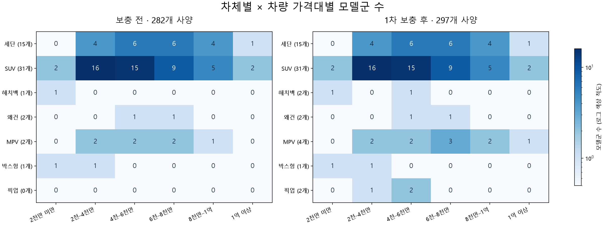

# 카탈로그 분포와 1차 보충 — 2026-10-27

프로젝트 DB(호스트 3307)의 공개 추천 카탈로그를 기준으로 집계했다. 기존 282개 사양을 보존하고 공식 가격·제원을 대조한 15개 사양을 V18 마이그레이션으로 추가했다. 적용 후 실제 API에서 297개를 확인했다.



| 차체 | 모델군 전 → 후 | 사양 전 → 후 |
| --- | ---: | ---: |
| 세단 | 15 → 15 | 91 → 91 |
| SUV | 31 → 31 | 163 → 163 |
| 해치백 | 1 → 2 | 6 → 9 |
| 왜건 | 2 → 2 | 2 → 2 |
| MPV | 2 → 4 | 14 → 18 |
| 박스형 | 1 → 1 | 6 → 6 |
| 픽업 | 0 → 2 | 0 → 8 |

## 집계 기준

- 모델군은 브랜드와 기본 모델을 기준으로 센다. 하이브리드·전기 파생형, GT·Black, 리무진 등은 `model-families.json`의 명시적 대응표로 합친다. Golf와 GTI도 하나로 합쳤다. 무쏘와 별도 플랫폼의 무쏘 EV는 별도 모델군이다. 카탈로그 원본 모델명 수는 JSON에 별도로 남긴다.
- 가격대는 원 단위로 `[0, 2천만)`, `[2천만, 4천만)`, `[4천만, 6천만)`, `[6천만, 8천만)`, `[8천만, 1억)`, `[1억, ∞)`이다. 경계 금액은 오른쪽 구간에 포함한다.
- 여러 트림의 가격대가 다르면 같은 모델군이 여러 열에 나타난다. 따라서 셀 합계는 전체 고유 모델군 수와 다르다.
- 숫자는 공개 카탈로그의 공급 분포이며 정원 미확인 사양도 포함한다. 특정 사용자에게 확정 추천 가능한 수를 뜻하지 않는다. 빈 셀은 카탈로그 공백이며 국내 시장에 판매 차량이 없다는 뜻은 아니다.
- 차체별 10개 모델군은 아직 달성하지 못했다. 트림을 늘려 모델군 부족을 해결했다고 판단하지 않는다.

## 추가 내용과 근거

| 모델 | 추가 사양 | 가격 범위 | 공식 근거 |
| --- | ---: | ---: | --- |
| 폭스바겐 Golf / GTI | 3 | 4,007만~5,275만 원 | [Golf](https://www.volkswagen.co.kr/ko/models/golf.html), [GTI](https://www.volkswagen.co.kr/ko/models/golf_gti.html)의 현재 연결 가격표 |
| KG모빌리티 무쏘 | 4 | 3,040만~4,040만 원 | [공식 카탈로그·가격표](https://www.kg-mobility.com/od/promotion/catalog-download) 및 공개 트림 목록 |
| KG모빌리티 무쏘 EV | 4 | 4,850만~5,380만 원 | 같은 공식 화면의 2027년형 10월 가격표·카탈로그 |
| 토요타 시에나 | 2 | 7,630만~7,700만 원 | [국내 공식 모델 페이지](https://www.toyota.co.kr/models/sienna/) |
| 토요타 알파드 | 2 | 8,790만~1억 180만 원 | [국내 공식 모델 페이지](https://www.toyota.co.kr/models/alphard/) |

VAT 포함 차량 가격이며 취득등록비·프로모션·보조금을 합치지 않았다. 무쏘의 디젤 M5와 무쏘 EV AWD는 공식 판매 트림 목록의 선택 사양 포함 가격과 대조했다. 골프는 2026년 6월 종료로 명시된 개소세 인하 금액을 사용하지 않았다. 자료에 명시되지 않은 연식을 추정하지 않았다.

정원은 시에나·알파드 4개 사양만 7인승으로 확정했다. 나머지 11개는 공식 가격표·카탈로그에서 숫자 정원을 확인하지 못해 `seats=null`, `seats_status=unknown`으로 두었다. 최소 인원 입력 시 조건부 후보로 분리되며 충족을 확정하지 않는다. 차량 전용 사진은 아직 수집하지 않았고 월 보험·세금·정비비에는 기존 공통 추정치가 적용된다. 특히 픽업의 화물 세제 특례는 개별 비용에 아직 반영하지 않았다.

왜건은 V60의 공식 시작가를 확인했지만 현재 트림·정원과 제원 결합 검수가 남아 보류했다. MINI는 최신 공식 PDF 다운로드가 시간 초과되어 오래된 가격으로 대체하지 않았다. 후속 대상과 보류 이유는 `collection-backlog.json`에 기록했다. 우선순위는 해치백 2천만~4천만 원, 왜건 6천만~1억 원, MPV의 다양한 독립 모델, 픽업 6천만 원 이상이다. 박스형은 국내 승용 시장의 실제 공급 범위를 먼저 확인한다.

## 파일과 재현

- `before.json` / `after.json`: 공개 차량 데이터 스냅샷. 회원·계정 정보는 포함하지 않는다.
- `additions.json`: DB에 추가한 15개 사양과 사양별 원문 URL.
- `sources.json`: 공식 PDF URL·SHA-256 및 검수 범위. 원본 PDF는 저장소에 복제하지 않았다.
- `distribution.csv` / `distribution.json` / `distribution.png`: 분포 표·상세 목록·그림.
- `runtime-verification.json`: 실행 중인 추천 API로 확인한 대표 시나리오.

프로젝트 루트에서 `tools/data/requirements.txt`의 의존성을 설치하고 실행한다.

```powershell
python tools/data/vehicles/build_catalog_distribution.py --before data/vehicles/catalog-expansion-20261027/before.json --after data/vehicles/catalog-expansion-20261027/after.json --aliases data/vehicles/catalog-expansion-20261027/model-families.json --output data/vehicles/catalog-expansion-20261027
```

DB 적용은 `back/src/main/resources/db/migration/V18__expand_sparse_vehicle_catalog.sql`을 Flyway가 수행한다. 기존 ID는 덮어쓰지 않는다. 이 작업에서 학습 체크포인트와 추천 조건식은 변경하지 않았다. 실행 중인 추천 서비스가 공개 카탈로그를 읽어 새 차량을 점수화하는 것을 확인했다. 데이터 확장은 추천 품질 향상 자체의 증명이나 재학습 완료를 뜻하지 않는다.

검증: 기존 282행 불변, 추가 15행과 검수 데이터 일치, Vehicle 도메인 검증, 가격대 경계와 모델군 중복 제거, 실시간 카탈로그 297행, 해치백·픽업·7인승 MPV 추천 및 정원 미확인 조건부 처리 확인.

전체 ML 회귀 테스트는 121개 중 119개 통과, 2개 실패했다. `test_population_partition`은 예시 브랜드의 차체 검증에서 오류가 발생했고, `test_seating_registry`는 과거 레지스트리와 보충 후보 16개 ID의 집합이 달랐다. 두 테스트는 이번 V18이나 `additions.json`을 읽지 않는다. 실패를 무시하거나 전체 테스트 통과로 표시하지 않았으며, 별도 정리가 필요하다. 백엔드 `classes` 빌드와 Flyway V18 적용은 성공했다.
