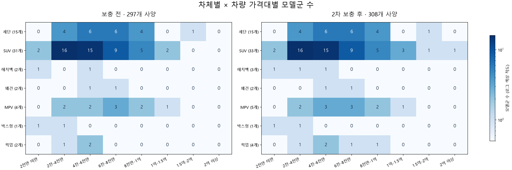
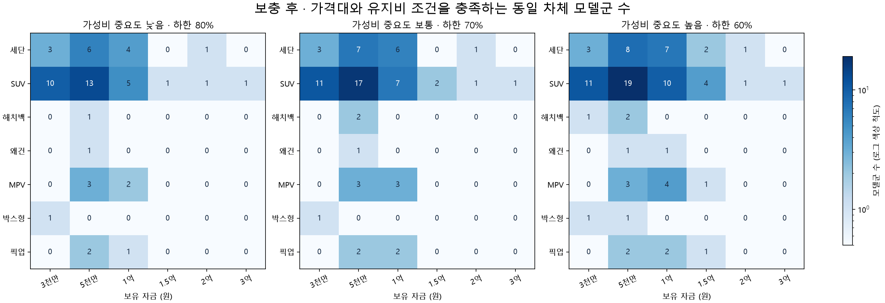

# 카탈로그 가격 구간 확대·2차 보충 결과 — 2026-10-27

추천 조건식과 학습 체크포인트를 유지했다. 1억 원은 상한이 아니다. 분포만 1억~1.5억, 1.5억~2억, 2억 이상으로 세분화했다. 2억 이상도 집계 구간이며 추천 가격 제한이 아니다.



## 실제 반영

- 공개 추천 카탈로그: **297 → 308개 사양**, **모델군 6개 증가**. 기존 297행은 수정하지 않았다.
- PV5 5·7인승 4개, Canyon 1개, Sierra 2개, HUMMER EV SUV 1개, 308 ALLURE 1개, Cayenne 2개 사양을 추가했다.
- LM 2개 사양과 V60 가격 참고 1개는 관리자 `REVIEW` 상태로 등록했다. 추천 API에는 포함되지 않는다.
- Flyway V19·V20 적용 성공. 3307 프로젝트 DB에 반영했으며 개인 DB 3306은 사용하지 않았다.

| 차체 | 모델군 전 → 후 | 사양 전 → 후 |
| --- | ---: | ---: |
| 세단 | 15 → 15 | 91 → 91 |
| SUV | 31 → 33 | 163 → 166 |
| 해치백 | 2 → 3 | 9 → 10 |
| 왜건 | 2 → 2 | 2 → 2 |
| MPV | 4 → 5 | 18 → 22 |
| 박스형 | 1 → 1 | 6 → 6 |
| 픽업 | 2 → 4 | 8 → 11 |

같은 모델의 파생형·트림은 `model-families.json`으로 합쳤다. 셀별 모델군 수는 가격대마다 중복될 수 있다. 가격 구간은 하한 포함·상한 제외이며, 맨 마지막 구간에는 상한이 없다. 정원 미확인 사양도 공급 분포에 포함되므로 확정 추천 가능한 모델 수와 같지 않다.

## 여러 자금 조건의 비교



자금 3천만·5천만·1억·1.5억·2억·3억 × 가성비 중요도 낮음·보통·높음 × 7개 차체 = 보충 전후 각각 **126개**, 총 **252개** 조건을 동일 모델로 비교했다. 월소득 360만 원, 생활비 180만 원, 저축 30만 원, 최소 월 여유 30만 원, 연 15,000km, 충전 가능, 최소 인원 미지정, 크기·연료 선호 없음, 차체 중요도 보통으로 고정했다. 비상금·명시적 구매 상한은 0이다. 개인별 구매 적정성을 입증하는 평가는 아니다.

- 같은 차체 후보가 없는 조건: **80 → 69개**.
- 후보가 없던 **11개 조건**을 채웠고, **18개 조건**에서 모델군이 늘었다.

차체 선호는 강제 필터가 아니므로 API가 다른 차체를 반환할 수 있다. 보고서는 반환 개수와 별도로 선호 차체의 가격·유지비 조건 충족 모델군을 센다. 가격 범위와 유지비 정책은 실제 운영 함수를 사용했다. 후보가 0개여도 자동으로 하한선을 낮추지 않았다.

가성비 중요도가 낮을 때 확인한 핵심 사례:

| 자금 | 적용 가격 범위 | 확인 결과 |
| --- | --- | --- |
| 1.5억 원 | 1.2억~1.5억 원 | 기존에는 전체 후보도 0개. Cayenne 기본형 1억 4,990만 원을 추가해 실제 API 추천 확인 |
| 2억 원 | 1.6억~2억 원 | Cayenne Black Edition 1억 6,290만 원 등 후보 확인 |
| 3억 원 | 2.4억~3억 원 | HUMMER EV SUV 2억 4,800만 원 실제 API 추천 확인 |

## 남은 공백의 의미

**남은 69개 조건을 시장 공급 부족으로 확정하지 않았다.** 빈 셀은 현재 카탈로그의 공백이며 전수조사 결과가 아니다. 이번 조사에서 시장 공급 부족으로 확정한 셀은 0개다. 현재 공식 자료가 있으나 조합 검수가 남은 V60·LM은 `검수 중`, 원문 조회가 막힌 BMW·MINI는 `검수 대기`, 아직 현행 판매 확인을 못 한 모델·구간은 `미수집·시장조사 필요`로 분리했다. 상세 목록은 `coverage-review.json`에 있다.

특히 왜건·박스형, 고가 해치백·MPV·픽업은 계속 부족하다. 차체별 10개 모델군을 달성했다고 판단하지 않으며, 트림 증가로 모델군 부족을 숨기지 않는다. 다음 수집은 BMW·MINI 공식 가격표 접근 및 V60의 현행 트림 검수, LM의 모델·가격·제원 연결 검수를 우선한다.

## 자료 품질과 한계

- 공식 가격과 제조사 현재 모델·견적 페이지, 카탈로그를 대조했다. 사양별 원문은 `additions.json`, PDF URL·SHA-256은 `sources.json`에 기록했다.
- 308 ALLURE는 현행 GT 전용 제원을 복사하지 않았다. Sierra의 전장·정원, Cayenne의 전장·해당 연식 국내 공인연비도 미확인으로 남겼다. 11개 추가 사양 중 숫자 정원 미확인은 3개다. 최소 인원을 지정하면 이들은 조건부 후보로 분리된다.
- 연비가 미확인이면 기존 연료별 추정 범위를 사용한다. 보험·세금·정비비는 기존 공통 추정치로, 개별 견적이나 픽업 화물 세제 특례를 완전히 반영하지 않는다.
- Porsche 가격에는 의무 소화기 비용·운송료 등이 별도라는 제조사 고지를 출처 기록에 남겼다. 모든 차량 가격은 옵션·취득등록비·보조금·할인 조건과 구분해야 한다.
- 새 차량의 전용 이미지는 미수집이다. 학습은 다시 하지 않았다. 학습 범위를 벗어난 가격·제원은 운영 API의 `outsideTrainingRange` 표시를 유지한다. 후보 수 증가는 추천 정확도나 만족도 향상의 증명이 아니다.

## 검증과 재현

- 추가 14개 레코드의 도메인 검증, 기존 297행 불변, 공개 11행과 검수 자료 일치, 비공개 3행 제외 확인.
- 실제 운영 API로 자금 3천만~3억의 가격 범위, 7인승 PV5, 고가 Cayenne·HUMMER 추천 확인.
- 관련 가격·좌석·차체·자금·동적 카탈로그 회귀 테스트 **52개 통과**. 앞선 전체 ML 검사에서 발견된 별도 레지스트리·합성 데이터 검사 2건은 이번 작업에서 수정하지 않았다.
- 분포 경계 1억·1.5억·2억·10억 및 비정상 가격 거부 확인. 백엔드 classes 빌드·마이그레이션 성공.

재현은 프로젝트 루트에서 실행한다. `tools/data/requirements.txt`와 ML 실행 의존성이 필요하다.

```powershell
python tools/data/vehicles/build_catalog_distribution.py --before data/vehicles/catalog-expansion-round2-20261027/before.json --after data/vehicles/catalog-expansion-round2-20261027/after.json --aliases data/vehicles/catalog-expansion-round2-20261027/model-families.json --output data/vehicles/catalog-expansion-round2-20261027 --after-label "2차 보충 후"
python tools/data/vehicles/evaluate_catalog_coverage.py --before data/vehicles/catalog-expansion-round2-20261027/before.json --after data/vehicles/catalog-expansion-round2-20261027/after.json --aliases data/vehicles/catalog-expansion-round2-20261027/model-families.json --model ml/outputs/models/candidate-preferences/20261027-seating-verified-v1 --output data/vehicles/catalog-expansion-round2-20261027
```
