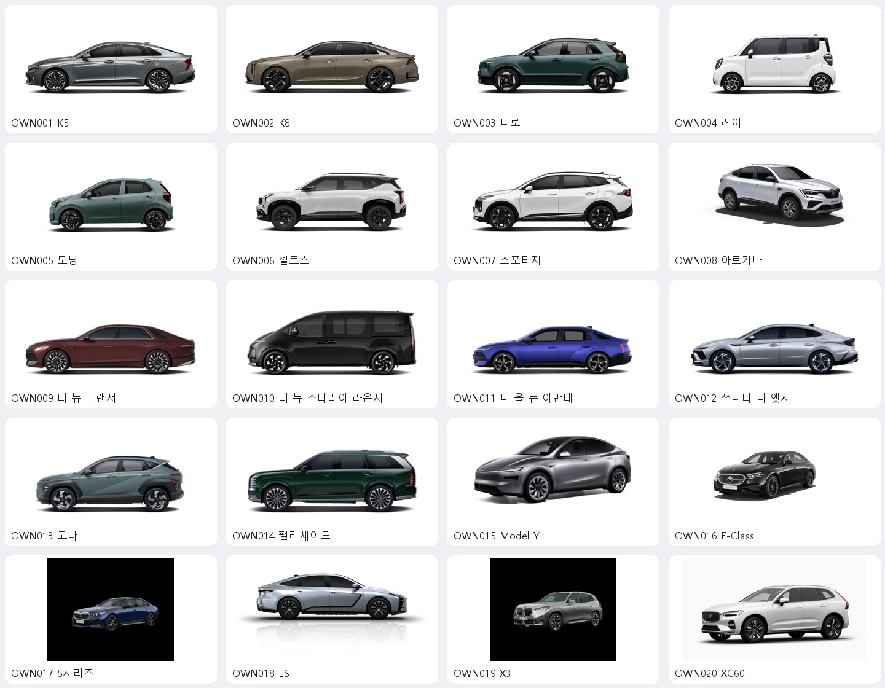

# 추천 차량 공식 이미지 검토본

최신 선정본: [전면 사선 구도 20종](front-three-quarter/README.md). 아래 내용은 최초 수집본 기록이다.

수집일: 2026-10-20 (Asia/Seoul)

추천 모델의 OWN001–OWN020 전체 20종을 대상으로 공식 제조사 홈페이지의 대표 이미지를 수집했다. 앱 UI에는 연결하지 않았다. 공식 이미지라는 사실이 재사용 허락을 의미하지 않으며, 저작권은 각 권리자에게 있다. 이번 묶음은 로컬 비교·검토 자료다.

## 품질 및 모델 일치

- 기아 7종: 1000×442 PNG. 흰 배경의 측면 대표 이미지.
- 아르카나: 공식 Iconic 차량 구성 이미지. 배경이 있는 홈페이지 홍보 사진 대신 선택했다.
- 현대 6종: 공식 목록의 290×130 PNG. 작은 썸네일 검토에 적합하고 큰 카드나 고밀도 화면에서는 흐려질 수 있다. 파일명에 공식 원본의 27my·27fl·27fc·26pe 식별자를 보존했다. 식별자만으로 차량 제원 전체의 일치를 보장하지 않는다.
- Model Y: 공식 메뉴의 440×248 PNG. 작은 메뉴용 원본이다.
- E-Class, XC60: 서버가 AVIF로 제공한 실제 형식을 보존했다. 파일 자체 디코딩 확인 완료.
- BMW 2종: 검은 스튜디오 배경의 공식 모델 목록 이미지. 첫 번째 이미지는 1128×921이며 여백이 크다. 촬영 배경 제거 등 원본 편집은 하지 않았다.
- ES: 현재 공식 사이트의 ES 350h. 추천 학습 자료가 이전 ES 300h를 뜻한다면 세대가 맞지 않을 수 있다.
- 최신 공식 홈페이지와 학습 자료의 연식·세대·트림이 일치하는지는 적용 전에 확인해야 한다. 앞선 대화의 '더 뉴 그랜저=IG' 단정은 현재 공식 홈페이지 명칭과 다를 수 있다.

## 파일과 출처

| 코드 | 추천 모델 | 로컬 이미지 | 공식 출처 |
|---|---|---|---|
| OWN001 | K5 | [이미지](images/OWN001-k5.png) | [제조사 페이지](https://www.kia.com/kr/vehicles/k5/features) |
| OWN002 | K8 | [이미지](images/OWN002-k8.png) | [제조사 페이지](https://www.kia.com/kr/vehicles/k8/features) |
| OWN003 | 니로 | [이미지](images/OWN003-niro.png) | [제조사 페이지](https://www.kia.com/kr/vehicles/niro/features) |
| OWN004 | 레이 | [이미지](images/OWN004-ray.png) | [제조사 페이지](https://www.kia.com/kr/vehicles/ray/features) |
| OWN005 | 모닝 | [이미지](images/OWN005-morning.png) | [제조사 페이지](https://www.kia.com/kr/vehicles/morning/features) |
| OWN006 | 셀토스 | [이미지](images/OWN006-seltos.png) | [제조사 페이지](https://www.kia.com/kr/vehicles/seltos/features) |
| OWN007 | 스포티지 | [이미지](images/OWN007-sportage.png) | [제조사 페이지](https://www.kia.com/kr/vehicles/sportage/features) |
| OWN008 | 아르카나 | [이미지](images/OWN008-arkana.webp) | [제조사 페이지](https://www.renault.co.kr/ko/model/arkana_overview.jsp) |
| OWN009 | 더 뉴 그랜저 | [이미지](images/OWN009-grandeur-27fl.png) | [제조사 페이지](https://www.hyundai.com/kr/ko/e/all-vehicles) |
| OWN010 | 더 뉴 스타리아 라운지 | [이미지](images/OWN010-staria-lounge-26pe.png) | [제조사 페이지](https://www.hyundai.com/kr/ko/e/all-vehicles) |
| OWN011 | 디 올 뉴 아반떼 | [이미지](images/OWN011-avante-27fc.png) | [제조사 페이지](https://www.hyundai.com/kr/ko/e/all-vehicles) |
| OWN012 | 쏘나타 디 엣지 | [이미지](images/OWN012-sonata-the-edge-27my.png) | [제조사 페이지](https://www.hyundai.com/kr/ko/e/all-vehicles) |
| OWN013 | 코나 | [이미지](images/OWN013-kona-27my.png) | [제조사 페이지](https://www.hyundai.com/kr/ko/e/all-vehicles) |
| OWN014 | 팰리세이드 | [이미지](images/OWN014-palisade-27my.png) | [제조사 페이지](https://www.hyundai.com/kr/ko/e/all-vehicles) |
| OWN015 | Model Y | [이미지](images/OWN015-model-y.png) | [제조사 페이지](https://www.tesla.com/ko_kr/modely) |
| OWN016 | E-Class | [이미지](images/OWN016-e-class.avif) | [제조사 페이지](https://www.mercedes-benz.co.kr/passengercars/models/saloon/e-class/overview.html) |
| OWN017 | 5시리즈 | [이미지](images/OWN017-bmw-5.jpg) | [제조사 페이지](https://www.bmw.co.kr/ko/all-models.html) |
| OWN018 | ES | [이미지](images/OWN018-lexus-es350h.webp) | [제조사 페이지](https://www.lexus.co.kr/models/ES-350h/) |
| OWN019 | X3 | [이미지](images/OWN019-bmw-x3.jpg) | [제조사 페이지](https://www.bmw.co.kr/ko/all-models.html) |
| OWN020 | XC60 | [이미지](images/OWN020-xc60.avif) | [제조사 페이지](https://www.volvocars.com/kr/cars/xc60/) |

manifest.json에는 차량별 원본 URL(확보된 경우), 출처 페이지, 파일 위치, 실제 포맷·해상도·투명도·SHA-256을 기록했다. BMW의 이전 검색 캐시 이미지 URL은 실패 기록(attemptedImageUrl)으로 남겼으며, 실제 수집 파일은 현재 공식 페이지에서 브라우저로 내려받았다. 동적 원본 URL을 안정적으로 보존하지 못한 BMW 2종은 출처 페이지를 기준으로 추적한다.

추가 비교용 OWN012-sonata-trim.png도 함께 보관했다. 기본 20종의 추천 카드 매핑 파일은 변경하지 않았다.
