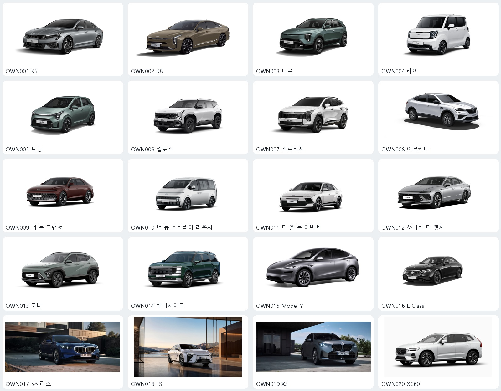

# 전면 사선 구도 공식 차량 이미지 20종

수집·재선정: 2026-10-20 (Asia/Seoul).

차량 전체가 보이고 앞면과 측면을 함께 확인할 수 있는 공식 신차 이미지를 골랐다. 투명 배경은 필수 조건이 아니다. 기존 수집본은 상위 폴더에 보존했다. 앱 UI는 수정하지 않았다.

- 기아 7종: 측면 대표 이미지에서 전면 사선 대표 이미지로 교체. 1000×442.
- 현대 6종: 측면 목록 이미지에서 공식 360도 외관 001 프레임으로 교체. 940×515.
- Model Y: 같은 사선 구도의 큰 원본으로 교체.
- BMW 5시리즈·X3: 검은 배경에 작게 표시되던 목록 이미지를 전면 사선 공식 홍보 사진으로 교체. 건물 배경이 있으므로 스튜디오 컷의 완전한 대체는 아니다.
- ES: 측면 대표 이미지를 ES 350h 전면 사선 홍보 사진으로 교체. 배경이 있는 대안이며, 기존 ES 300h와 세대 일치는 확인이 필요하다.
- 아르카나·E-Class·XC60: 기존 공식 사선 이미지 유지.
- 총 17종은 단정한 스튜디오·단색·투명 배경 계열이며, 3종(BMW 2종·ES)은 배경이 있는 공식 홍보 사진이다.

원본을 잘라내거나 배경을 제거하지 않았다. 미리보기만 격자에 맞춰 축소했다. 저작권 및 재사용 허락 상태는 기존과 동일하게 미확인이다. 차량 사진의 세대·연식·트림은 학습 라벨과 별도 대조해야 한다. 특히 현재 공식 명칭의 그랜저·아반떼 및 ES·X3에 주의한다.

| 코드 | 모델 | 이미지 | 해상도 | 공식 출처 |
|---|---|---|---|---|
| OWN001 | K5 | [원본](images/OWN001-front-three-quarter.png) | 1000×442 | [제조사 페이지](https://www.kia.com/kr/vehicles/k5/features) |
| OWN002 | K8 | [원본](images/OWN002-front-three-quarter.png) | 1000×442 | [제조사 페이지](https://www.kia.com/kr/vehicles/k8/features) |
| OWN003 | 니로 | [원본](images/OWN003-front-three-quarter.png) | 1000×442 | [제조사 페이지](https://www.kia.com/kr/vehicles/niro/features) |
| OWN004 | 레이 | [원본](images/OWN004-front-three-quarter.png) | 1000×442 | [제조사 페이지](https://www.kia.com/kr/vehicles/ray/features) |
| OWN005 | 모닝 | [원본](images/OWN005-front-three-quarter.png) | 1000×442 | [제조사 페이지](https://www.kia.com/kr/vehicles/morning/features) |
| OWN006 | 셀토스 | [원본](images/OWN006-front-three-quarter.png) | 1000×442 | [제조사 페이지](https://www.kia.com/kr/vehicles/seltos/features) |
| OWN007 | 스포티지 | [원본](images/OWN007-front-three-quarter.png) | 1000×442 | [제조사 페이지](https://www.kia.com/kr/vehicles/sportage/features) |
| OWN008 | 아르카나 | [원본](images/OWN008-arkana.webp) | 1280×720 | [제조사 페이지](https://www.renault.co.kr/ko/model/arkana_overview.jsp) |
| OWN009 | 더 뉴 그랜저 | [원본](images/OWN009-front-three-quarter.png) | 940×515 | [제조사 페이지](https://www.hyundai.com/kr/ko/e/vehicles/the-new-grandeur/intro) |
| OWN010 | 더 뉴 스타리아 라운지 | [원본](images/OWN010-front-three-quarter.png) | 940×515 | [제조사 페이지](https://www.hyundai.com/kr/ko/e/vehicles/the-new-staria-lounge/intro) |
| OWN011 | 디 올 뉴 아반떼 | [원본](images/OWN011-front-three-quarter.png) | 940×515 | [제조사 페이지](https://www.hyundai.com/kr/ko/e/vehicles/the-all-new-avante/intro) |
| OWN012 | 쏘나타 디 엣지 | [원본](images/OWN012-front-three-quarter.png) | 940×515 | [제조사 페이지](https://www.hyundai.com/kr/ko/e/vehicles/sonata-the-edge/intro) |
| OWN013 | 코나 | [원본](images/OWN013-front-three-quarter.png) | 940×515 | [제조사 페이지](https://www.hyundai.com/kr/ko/e/vehicles/kona/intro) |
| OWN014 | 팰리세이드 | [원본](images/OWN014-front-three-quarter.png) | 940×515 | [제조사 페이지](https://www.hyundai.com/kr/ko/e/vehicles/palisade/intro) |
| OWN015 | Model Y | [원본](images/OWN015-model-y.png) | 1025×577 | [제조사 페이지](https://www.tesla.com/ko_kr/modely) |
| OWN016 | E-Class | [원본](images/OWN016-e-class.avif) | 1280×720 | [제조사 페이지](https://www.mercedes-benz.co.kr/passengercars/models/saloon/e-class/overview.html) |
| OWN017 | 5시리즈 | [원본](images/OWN017-bmw-5.webp) | 1024×448 | [제조사 페이지](https://www.bmw.co.kr/ko/all-models/5-series/sedan/bmw-5-series-sedan-overview.html) |
| OWN018 | ES | [원본](images/OWN018-lexus-es350h.webp) | 3840×2160 | [제조사 페이지](https://www.lexus.co.kr/models/ES-350h/) |
| OWN019 | X3 | [원본](images/OWN019-bmw-x3.webp) | 1024×448 | [제조사 페이지](https://www.bmw.co.kr/ko/all-models/x-series/x3/bmw-x3.html) |
| OWN020 | XC60 | [원본](images/OWN020-xc60.avif) | 3840×2161 | [제조사 페이지](https://www.volvocars.com/kr/cars/xc60/) |

manifest.json에 원본 URL, 출처 페이지, 구도, 배경 분류, 포맷, 해상도 및 SHA-256을 기록했다.
