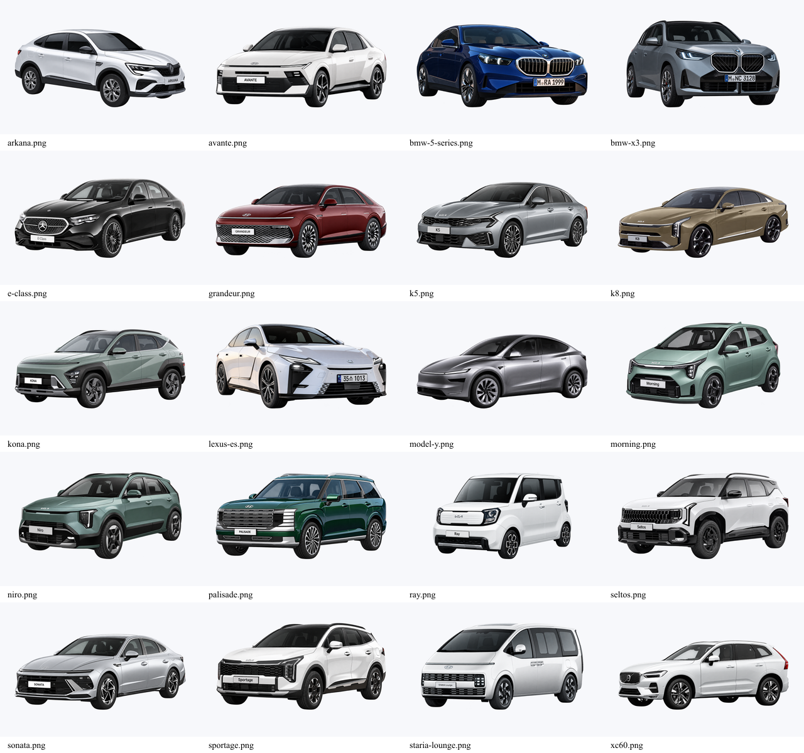

# 추천 카드용 배경 제거 편집본

2026-10-20, 내장 imagegen 도구로 원본 20종을 각각 편집했다. 수집 원본과 출처 기록은 유지하며, 앱은 `front/public/images/recommendations/cutouts/`의 PNG 파일을 사용한다.

## 편집 프롬프트

각 사진을 편집 대상으로 지정하고 아래 공통 지시를 적용했다. K5 첫 요청은 동일한 배경 제거·차량 보존·크기 정렬 기준을 사용했다.

> Use case: background-extraction. Edit this exact vehicle photo. Remove entire background, scenery, floor, ground shadows and reflections outside the car; genuine transparent alpha. Keep exact vehicle model, all car details, body color, wheels, logo, plate, photographic appearance and original camera angle unchanged. One isolated complete uncropped car only. Standardize output to 1536x1024 landscape transparent canvas. Center car horizontally; visible car bounds fit within width 85% and height 65% of canvas, preserve proportions. Tires baseline at 80% image height. No text or added objects.

`transparent_background: true`를 지정했다. AVIF 2종은 도구에서 확인할 수 있도록 PNG로 포맷만 변환해 입력했다.

## 규격 정렬

편집 결과의 차량 영역을 알파값 200 초과 기준으로 찾고 경계에 3px를 더했다. 차량 비율을 유지해 최대 1306×666 영역에 맞춘 다음, 1536×1024 투명 캔버스에서 가로 중앙·하단 820px에 배치했다. 화면 크기와 관계없이 카드 이미지 비율은 3:2로 유지한다.

편집본의 파일명은 원본과 같으며 확장자는 모두 `.png`다. AI 편집본은 제조사 원본 파일 자체와 구별해 사용한다.
